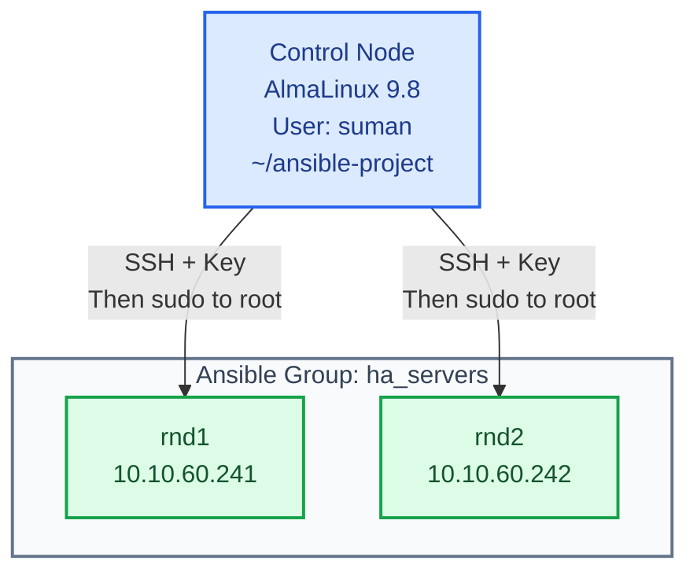

# Ansible Setup Guide

A step by step guide to the Ansible automation server running on AlmaLinux 9.8. It first explains how Ansible works, both by default and in the other ways it can be arranged, then shows how our architecture is built, and finally walks through every setup step we performed.

https://docs.ansible.com/projects/ansible/latest/installation_guide/installation_distros.html
---

## Table of Contents

1. [What This Guide Covers](#1-what-this-guide-covers)
2. [How Ansible Works](#2-how-ansible-works)
   - [2.1 The basic idea](#21-the-basic-idea)
   - [2.2 The pieces Ansible needs](#22-the-pieces-ansible-needs)
   - [2.3 How Ansible behaves by default](#23-how-ansible-behaves-by-default)
   - [2.4 Other ways to set Ansible up](#24-other-ways-to-set-ansible-up)
   - [2.5 How our architecture is set up](#25-how-our-architecture-is-set-up)
   - [2.6 How a run flows in our setup](#26-how-a-run-flows-in-our-setup)
   - [2.7 What each tool does](#27-what-each-tool-does)
3. [Prepare the Control Node](#3-prepare-the-control-node)
4. [Create the Project Folder](#4-create-the-project-folder)
5. [Install Navigator and Helper Tools](#5-install-navigator-and-helper-tools)
6. [Download Collections into the Project](#6-download-collections-into-the-project)
7. [Configure Ansible](#7-configure-ansible)
   - [7.1 ansible.cfg](#71-ansiblecfg)
   - [7.2 The inventory file](#72-the-inventory-file)
   - [7.3 ansible-navigator.yml](#73-ansible-navigatoryml)
   - [7.4 Tell the shell which config to use](#74-tell-the-shell-which-config-to-use)
8. [Set Up SSH Access to the Managed Hosts](#8-set-up-ssh-access-to-the-managed-hosts)
9. [Verify the Setup](#9-verify-the-setup)
10. [Write and Run a Playbook](#10-write-and-run-a-playbook)
11. [Roles, Galaxy and Vault in Practice](#11-roles-galaxy-and-vault-in-practice)
12. [Troubleshooting](#12-troubleshooting)
13. [Quick Reference](#13-quick-reference)

---

## 1. What This Guide Covers

Our environment:

- **Control node:** AlmaLinux 9.8, the machine where Ansible is installed and all commands are run
- **Control user:** `suman`, the one user who runs everything (never with `sudo` in front of an Ansible command)
- **Managed hosts:** `rnd1` (10.10.60.241) and `rnd2` (10.10.60.242), grouped as `ha_servers`
- **Project folder:** `/home/suman/ansible-project`
- **Connection:** SSH with a dedicated key, then `sudo` to root on the managed hosts


---

## 2. How Ansible Works

### 2.1 The basic idea

Ansible is **agentless**. Nothing special is installed on the servers we manage. we work from one machine, the control node, and Ansible reaches the other machines over SSH.

For every task, Ansible does the following:

1. Connects to the managed host over SSH.
2. Copies a small Python program (called a module) to a temporary folder on that host.
3. Runs the module, usually with `sudo`.
4. Reads the result, deletes the temporary files, and reports `ok`, `changed`, `failed` or `unreachable`.

Because modules describe a desired state ("this file exists", "this package is installed") rather than a series of steps, running the same task twice does not change anything the second time. This is called being idempotent.

### 2.2 The pieces Ansible needs

Before it can do any work, Ansible has to answer six questions:

- **Which settings should I use?** This is the configuration file, `ansible.cfg`.
- **Which machines should I manage?** This is the inventory, a list of hosts and groups.
- **Which modules can I use?** Modules come built in or from collections, which are downloadable bundles of modules.
- **What should I do?** This is a playbook, a YAML file that lists tasks for a group of hosts. Tasks that are reused across playbooks can be packaged as roles.
- **How do I log in?** This is the SSH user and key, plus how to become root (`sudo`).
- **How do I handle secrets?** Ansible Vault encrypts them.

### 2.3 How Ansible behaves by default

If we install Ansible and change nothing, it looks in shared, system-wide places:

- Settings come from `/etc/ansible/ansible.cfg`, if that file exists.
- The host list comes from `/etc/ansible/hosts`. Editing it needs root, and every user on the machine shares it.
- Collections come from `/usr/share/ansible/collections` (the ones bundled by the package) and from `~/.ansible/collections` in our home folder.
- Roles come from `~/.ansible/roles`, `/usr/share/ansible/roles` and `/etc/ansible/roles`.
- It logs in as the same user name we are using on the control node, and it does not use `sudo` unless we ask for it.
- It checks SSH host keys and will ask we to confirm a new host the first time.
- It runs directly on the control node using the locally installed Python and modules.

This works for a quick test, but the files are scattered across the system, cannot easily be kept in Git, and are shared by every user.

### 2.4 Other ways to set Ansible up

Each part of the setup can be moved somewhere else.

**Where the host list can live**
- In a file given on the command line with `-i`, for example `ansible-playbook -i myhosts site.yml`.
- In an environment variable, `ANSIBLE_INVENTORY`.
- In a file named inside `ansible.cfg` with `inventory =.`.
- In a folder of inventory files, one folder per environment such as staging and production.
- In a dynamic inventory plugin that asks a cloud provider or other system for the current list of servers.

**Where the config file can live**

Ansible uses the first one it finds, in this order: the file named in the `ANSIBLE_CONFIG` variable, then `ansible.cfg` in the current folder, then `~/.ansible.cfg`, then `/etc/ansible/ansible.cfg`.

**Where collections can live**
- In the system folder, which means whatever the OS package provides.
- In the user's own folder, `~/.ansible/collections`.
- In a folder inside the project, which keeps the exact versions together with the playbooks.
- In a requirements file that lists versions, installed on demand with `ansible-galaxy`.
- Inside a container image, called an Execution Environment.

**How playbooks can be run**
- With `ansible` and `ansible-playbook` directly on the control node.
- With `ansible-navigator` directly on the control node, which gives better output and an interactive viewer.
- With `ansible-navigator` inside a container, which gives an identical environment everywhere but needs podman or docker.
- With a platform such as AWX, Red Hat Ansible Automation Platform or Semaphore, which add a web interface, scheduling and access control.
- From a CI/CD pipeline that runs playbooks after a commit or merge.

### 2.5 How our architecture is set up

We picked the simplest arrangement that is still tidy and repeatable:

- **One project folder** (`~/ansible-project`) holds everything: config, inventory, playbooks, roles, collections and vault files. This keeps it in one place and ready for Git.
- **A project config file** (`ansible.cfg`) is selected with the `ANSIBLE_CONFIG` variable, so Ansible finds the same settings whichever folder we run it from. We had an early problem where running from the home folder gave an empty host list, and this fixes it.
- **A project inventory file** is named inside `ansible.cfg`, so no `-i` flag is needed. It is not kept in `/etc/ansible/hosts`, which would need root and be shared.
- **Collections are downloaded into the project** (`~/ansible-project/collections`), and the system folder stays as a fallback. The project copies fix the versions we use, and the fallback means things keep working if a collection has not been downloaded.
- **Plain `ansible-playbook` and `ansible-navigator` without a container** do the running. Nothing extra is needed, and navigator can move to containers later without any playbook changes.
- **One user, `suman`, with an SSH key and passwordless sudo** is used on every host. There are no passwords in files, and there is one clear account to audit.

### 2.6 How a run flows in our setup

```
suman runs:  ansible-playbook playbooks/create-file.yml
             (or: ansible-navigator run playbooks/create-file.yml)
       
1. ANSIBLE_CONFIG points to ~/ansible-project/ansible.cfg
   It supplies: inventory path, roles path, collections path,
   SSH key, remote user, sudo settings

2. The inventory turns the group name into hosts
   ha_servers  ->  rnd1 (10.10.60.241) and rnd2 (10.10.60.242)

3. The playbook is read: plays, tasks, and any roles from ansible-roles/
   
4. Each task's module is found in:
   ~/ansible-project/collections, then /usr/share/ansible/collections,
   then the built-in ansible.builtin
       
5. Ansible connects over SSH as suman with ~/.ssh/ansible_key
   and uses sudo to become root on each host

6. The module runs on the host and returns ok, changed or failed

7. A summary is printed (or browsed in ansible-navigator)
```



### 2.7 What each tool does

- **ansible** runs one module on our hosts as a single command, for example a ping or creating a file. It is good for quick jobs.
- **ansible-playbook** runs a whole playbook, which is a saved list of tasks we can repeat and share.
- **ansible-navigator** is a front end for the same engine. It reads `ansible-navigator.yml`, shows results in plain text or an interactive screen, and can show module documentation. In our setup it runs without a container, so it uses the same Ansible and collections as the other commands.
- **ansible-galaxy** downloads and manages collections and roles. We use it to put `community.general` and `ansible.posix` into the project's `collections` folder, and it can also create the folder lawet for a new role.
- **Roles** are reusable packages of tasks, files, templates and variables that live in `ansible-roles/`. A playbook can list a role by name instead of repeating all its tasks.
- **ansible-vault** encrypts files and strings so passwords and keys can be stored safely in the project.
- **ansible-lint** checks playbooks for mistakes and bad practices. It was installed together with ansible-navigator.

---

## 3. Prepare the Control Node

These commands install Ansible. Run them as root or as a user that already has sudo.

```bash
# To bring the system packages up to date before installing new software, so there are no version conflicts 
sudo dnf update -y

# To enable the EPEL repository, because the Ansible package for AlmaLinux 9 comes from it
sudo dnf install -y epel-release

# To install Ansible and its bundled collections on the control node
sudo dnf install -y ansible

# To confirm the Ansible version, the config file in use and the Python it runs on
ansible --version

# To see which collections were bundled with the package
ansible-galaxy collection list
```

Make sure `suman` can use `sudo` on the control node, which is needed for installing packages:

```bash
# To check that the user suman exists and see which groups it belongs to
id suman

# To add suman to the wheel group, which AlmaLinux uses to grant sudo rights
sudo usermod -aG wheel suman
```

Log out and log in again as `suman` so that the new group takes effect. From here on, every command is run as `suman`.

---

## 4. Create the Project Folder

```bash
# To create the project folder that will hold all Ansible content in one place
mkdir -p ~/ansible-project

# To move into the project folder so the following commands create things inside it
cd ~/ansible-project

# To create the folders for ad-hoc notes, roles, vault files, collections and playbooks
mkdir -p ad-hoc ansible-roles ansible-vault collections playbooks

# To create the empty config, inventory and starter files that are filled in later
touch ansible-navigator.yml ansible.cfg basic-ubuntu-setup.yml inventory

# To confirm the folders were created as planned
ls -l
```

The result:

```
ansible-project/
├── ad-hoc/                  one-off command notes
├── ansible-roles/           reusable roles
├── ansible-vault/           encrypted secrets
├── collections/             collections downloaded for this project
├── playbooks/               playbooks
├── ansible-navigator.yml    navigator settings
├── ansible.cfg              Ansible settings
├── basic-ubuntu-setup.yml   starter playbook for Debian or Ubuntu hosts
└── inventory                list of managed hosts
```

---

## 5. Install Navigator and Helper Tools

```bash
# To install pip so Python tools can be installed, sshpass for password based SSH during first contact, and tree to view folders
sudo dnf install -y python3-pip sshpass tree

# To install ansible-navigator for the current user only, so system Python packages stay untouched
pip3 install --user ansible-navigator

# To confirm that ansible-navigator installed correctly
ansible-navigator --version
```

If the last command says `command not found`, pip placed the program in `~/.local/bin`, which is not in our PATH yet:

```bash
# To add ~/.local/bin to PATH, because pip installs user programs there
echo 'export PATH=$HOME/.local/bin:$PATH' >> ~/.bashrc

# To load the change into the current shell without logging out
source ~/.bashrc
```

---

## 6. Download Collections into the Project

The system package already provides collections, but we also keep our own copies in the project so the versions stay fixed with the project.

```bash
# To check what is installed system-wide before downloading anything, so we know the starting point
ansible-galaxy collection list | grep -E "community.general|ansible.posix"

# To download the two collections used by our playbooks into the project collections folder (needs internet)
cd ~/ansible-project
ansible-galaxy collection install community.general ansible.posix -p ./collections/

# To confirm the files landed in the ansible_collections subfolder, which Ansible requires
ls -l collections/ansible_collections/

# To list the collections found in the project folder and confirm the install worked
ansible-galaxy collection list -p ./collections/
```

Collections are placed under `collections/ansible_collections/`, for example `ansible_collections/community/general`. This subfolder name is required by Ansible, so do not move the files up a level.

---

## 7. Configure Ansible

### 7.1 ansible.cfg

```bash
# To write the project-wide settings in one file so commands need no extra flags
cat > ~/ansible-project/ansible.cfg <<'EOF'
[defaults]
# To point Ansible at our inventory with an absolute path, so it works from any folder
inventory = /home/suman/ansible-project/inventory
# To tell Ansible where project roles live
roles_path = /home/suman/ansible-project/ansible-roles
# To search project collections first and fall back to the system collections
collections_path = /home/suman/ansible-project/collections:/usr/share/ansible/collections
# To log in to the managed hosts with our dedicated key
private_key_file = ~/.ssh/ansible_key
# To log in as suman on every managed host
remote_user = suman
# To skip the host key question on first connection, acceptable in a trusted lab network
host_key_checking = False
# To let Ansible find Python on each host without printing warnings
interpreter_python = auto_silent

[privilege_escalation]
# To run tasks as root by default, because most system changes need it
become = true
# To choose root as the target of the privilege escalation
become_user = root
# To use sudo as the escalation method
become_method = sudo
# To never prompt for a sudo password, which needs passwordless sudo on the hosts
become_ask_pass = false
EOF
```

Two things to remember:

- The valid setting names are `roles_path` and `collections_path`. Writing `roles=` or `collections=` is silently ignored.
- In production, set `host_key_checking = True` after the hosts are in `~/.ssh/known_hosts`.

### 7.2 The inventory file

```bash
# To list the managed servers and group them, so playbooks can target ha_servers by name
cat > ~/ansible-project/inventory <<'EOF'
[ha_servers]
rnd1 ansible_host=10.10.60.241
rnd2 ansible_host=10.10.60.242
EOF
```

`rnd1` and `rnd2` are names that only Ansible knows. It connects to the address in `ansible_host`, so `ping rnd1` in a shell will fail with "Name or service not known". That is normal.

### 7.3 ansible-navigator.yml

```bash
# To make ansible-navigator run directly on the control node, so no podman or container image is needed
cat > ~/ansible-project/ansible-navigator.yml <<'EOF'
---
ansible-navigator:
  execution-environment:
    enabled: false
  mode: stdout
  logging:
    level: warning
EOF
```

### 7.4 Tell the shell which config to use

```bash
# To make every Ansible command use our project config no matter which folder it is run from
echo 'export ANSIBLE_CONFIG=$HOME/ansible-project/ansible.cfg' >> ~/.bashrc

# To load the new variable into the current shell without logging out
source ~/.bashrc

# To move into the project folder for the next steps
cd ~/ansible-project

# To print the inventory as a tree and confirm that rnd1 and rnd2 appear under ha_servers
ansible-inventory --graph
```

---

## 8. Set Up SSH Access to the Managed Hosts

Ansible logs in as `suman` using a key, so no password is typed during runs.

```bash
# To create a dedicated key pair for Ansible, so automation access is separate from personal keys
ssh-keygen -t ed25519 -f ~/.ssh/ansible_key -N ""

# To restrict the .ssh folder to its owner, because SSH rejects folders with open permissions
chmod 700 ~/.ssh

# To make the private key readable only by suman, because anyone holding it can log in to the hosts
chmod 600 ~/.ssh/ansible_key

# To leave the public key readable, since it is meant to be shared
chmod 644 ~/.ssh/ansible_key.pub

# To install the public key on rnd1 so suman can log in without a password (asks for the password once)
ssh-copy-id -i ~/.ssh/ansible_key.pub suman@10.10.60.241

# To install the public key on rnd2 for the same reason
ssh-copy-id -i ~/.ssh/ansible_key.pub suman@10.10.60.242

# To test the key login on rnd1 before running any Ansible command
ssh -i ~/.ssh/ansible_key suman@10.10.60.241 hostname
```

Our configuration never asks for a sudo password, so `suman` needs passwordless sudo on **every managed host**. We found this the hard way on `rnd2`, which failed with "Missing sudo password" until it was set. Log in to each host (`ssh -i ~/.ssh/ansible_key suman@<ip>`) and run:

```bash
# To allow suman to run sudo without a password, so automated runs never stop at a prompt
echo "suman ALL=(ALL) NOPASSWD:ALL" | sudo tee /etc/sudoers.d/suman

# To apply the strict permissions that sudo requires for files in /etc/sudoers.d
sudo chmod 440 /etc/sudoers.d/suman

# To check the syntax of the sudoers file, because a broken file can lock everyone out of sudo
sudo visudo -cf /etc/sudoers.d/suman
```

Keep `~/.ssh/ansible_key` private. Anyone who has it can become root on the managed hosts.

---

## 9. Verify the Setup

```bash
# To move into the project folder
cd ~/ansible-project

# To confirm Ansible loaded our project config file and not a default one
ansible --version | grep "config file"

# To confirm the collection search path includes the project collections folder
ansible-config dump | grep COLLECTIONS_PATH

# To test SSH, Python and sudo on every host at once, expecting a pong from rnd1 and rnd2
ansible all -m ping

# To confirm the login user on the hosts is suman, by turning privilege escalation off for this one command
ansible all -m command -a "whoami" -e ansible_become=false

# To confirm that sudo works and tasks run as root
ansible all -m command -a "whoami"

# To create a file on both hosts, which proves Ansible can change remote state
ansible all -m copy -a "dest=/tmp/hello.txt content='Created by Ansible\n' mode=0644"

# To read the file back from the hosts and confirm its content
ansible all -m command -a "cat /tmp/hello.txt"
```

A successful file creation shows `CHANGED` for both hosts, with `owner: root`, because the task ran through sudo. Running the same command again shows `SUCCESS` with `changed: false`.

---

## 10. Write and Run a Playbook

```bash
# To save the file creation task as a playbook, so it can be repeated and shared instead of typed each time
cat > ~/ansible-project/playbooks/create-file.yml <<'EOF'
---
- name: Create a file on remote hosts
  hosts: ha_servers
  tasks:
    - name: Create /tmp/hello.txt
      ansible.builtin.copy:
        dest: /tmp/hello.txt
        content: "Created by Ansible on {{ inventory_hostname }}\n"
        mode: "0644"
EOF

# To check the playbook syntax before it touches any server
ansible-playbook ~/ansible-project/playbooks/create-file.yml --syntax-check

# To preview what would change without changing anything
ansible-playbook ~/ansible-project/playbooks/create-file.yml --check --diff

# To run the playbook on the ha_servers group
ansible-playbook ~/ansible-project/playbooks/create-file.yml

# To run the same playbook through ansible-navigator with plain terminal output
cd ~/ansible-project && ansible-navigator run playbooks/create-file.yml -m stdout

# To run the playbook against a single host while testing
ansible-playbook ~/ansible-project/playbooks/create-file.yml --limit rnd1

# To check the playbooks for mistakes and bad practices
ansible-lint ~/ansible-project/playbooks/
```

Note on `basic-ubuntu-setup.yml`: it uses `apt` and `ufw`, so it suits Debian and Ubuntu hosts only. Its `hosts:` line must name a group that exists in the inventory (for us, `ha_servers`). For AlmaLinux or RHEL hosts, use `ansible.builtin.dnf` and `ansible.posix.firewalld` instead.

---

## 11. Roles, Galaxy and Vault in Practice

**Roles**

```bash
# To create the standard role folder lawet, so every role is organised the same way
cd ~/ansible-project/ansible-roles && ansible-galaxy role init webserver
```

A role contains `tasks/` (what to do), `handlers/` (actions such as restarting a service), `templates/` (files filled in per host), `files/` (static files), `defaults/` and `vars/` (variables), and `meta/` (information and dependencies). A playbook uses it like this:

```yaml
---
- name: Configure web servers
  hosts: ha_servers
  roles:
    - webserver
```

**Galaxy**

```bash
# To record exact collection versions in a file, so the same versions can be installed again later
cat > ~/ansible-project/collections/requirements.yml <<'EOF'
---
collections:
  - name: community.general
  - name: ansible.posix
EOF

# To install everything listed in the requirements file into the project
ansible-galaxy collection install -r ~/ansible-project/collections/requirements.yml -p ~/ansible-project/collections/
```

**Vault**

```bash
# To create an encrypted file for secrets, so passwords are never stored in plain text
ansible-vault create ~/ansible-project/ansible-vault/secrets.yml

# To edit the encrypted file later without leaving a decrypted copy on disk
ansible-vault edit ~/ansible-project/ansible-vault/secrets.yml

# To run a playbook that uses vaulted variables, typing the vault password when asked
ansible-playbook ~/ansible-project/playbooks/create-file.yml --ask-vault-pass
```

---

## 12. Troubleshooting

These are the problems we actually met:

- **"provided hosts list is empty, only localhost is available"**
  Ansible did not find our config or inventory, usually because the command was run from the home folder or `inventory =` pointed to a wrong path. Set `ANSIBLE_CONFIG` (section 7.4) and check the path in `ansible.cfg`.
- **"Missing sudo password" on one host**
  `suman` has no passwordless sudo on that host. Create `/etc/sudoers.d/suman` there (section 8).
- **`ping rnd2` says "Name or service not known"**
  `rnd2` is only an Ansible name. Ping the IP, or use `ansible rnd2 -m ping`.
- **`ansible-galaxy collections list` shows a usage error**
  The word is singular: `ansible-galaxy collection list`.
- **`andible: command not found`**
  A typo. The command is `ansible`.
- **`collections/` is empty after installing Ansible**
  The system package only provides system collections. Download project copies with `ansible-galaxy collection install. -p ./collections/` (section 6).
- **Login fails with a wrong user name**
  Check `remote_user = suman` in `ansible.cfg`. A typo such as `ssuman` will be refused.
- **A setting seems ignored**
  Use `roles_path` and `collections_path`, not `roles` and `collections`.
- **`Permission denied (publickey)`**
  The key is not on the host or the user name is wrong. Run `ssh-copy-id` again.
- **`ansible-navigator: command not found`**
  Add `~/.local/bin` to PATH (section 5).
- **`couldn't resolve module/action`**
  The collection that provides that module is missing. Install it with `ansible-galaxy collection install`.

To see every step of a failing connection:

```bash
# To show full SSH and module detail for one failing host, which usually reveals the real cause
ansible rnd2 -m ping -vvv
```

---

## 13. Quick Reference

```bash
# To check that every managed host is reachable and can run Ansible modules
ansible all -m ping

# To run one command on every host
ansible all -m command -a "uptime"

# To gather system facts from one host
ansible rnd1 -m setup

# To preview a playbook's changes without applying them
ansible-playbook playbooks/<name>.yml --check --diff

# To run a playbook on only one host
ansible-playbook playbooks/<name>.yml --limit rnd1

# To show how the inventory is organised
ansible-inventory --graph

# To list the collections installed in the project
ansible-galaxy collection list -p ~/ansible-project/collections/

# To print only the settings that differ from the defaults, confirming our ansible.cfg is active
ansible-config dump --only-changed
```
